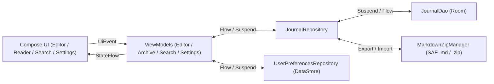

# ARCHITECTURE.md — Architecture & Cartographie du Code

> Ce document décrit les Use Cases de référence, l'architecture cible, le flux de données et l'emplacement exact des fichiers du projet **Journal** afin d'éviter toute exploration inutile du codebase.

---

## 1. Use Cases Nominaux Validés

- **Acteur** : Utilisateur souhaitant écrire son journal quotidien sans distraction, relire ses anciens journaux, rechercher un mot précis ou sauvegarder/transférer ses écrits en `.md` et `.zip`.
- **Parcours 1 — Écriture immédiate & Continuité toute la journée (dont passage de minuit)** :
    1. L'utilisateur ouvre **Journal** : l'application affiche immédiatement l'écran d'édition du jour avec en titre la date complète du jour (ex. *« Lundi 9 novembre 2026 »*).
    2. Si une entrée existe déjà pour aujourd'hui, son contenu est chargé et prêt à être complété. Sinon, la page est vierge.
    3. L'écran reste allumé (`keepScreenOn`) même si l'utilisateur pose son téléphone pour réfléchir.
    4. Si l'utilisateur écrit à `23h55` et que l'horloge passe à `00h00`, la session garde la date d'ancrage initiale : l'écriture ne s'interrompt pas et continue dans le même journal.
- **Parcours 2 — Consultation des anciens journaux (Lecture seule stricte)** :
    1. L'utilisateur ouvre l'historique des journaux précédents et sélectionne une date passée.
    2. Le journal s'ouvre en **mode lecture seule** (`readOnly`) : aucun clavier ne s'ouvre, le texte est sélectionnable/copiable mais strictement non modifiable.
- **Parcours 3 — Recherche d'occurrences & Saut direct à l'endroit du texte** :
    1. L'utilisateur saisit un mot ou une expression dans l'écran de recherche.
    2. L'application affiche la liste détaillée de toutes les occurrences trouvées (date du journal + extrait de phrase mettant le mot en évidence).
    3. Au clic sur une occurrence, l'application ouvre le journal correspondant, fait défiler automatiquement la page (`scroll`) jusqu'à l'emplacement exact de cette occurrence et la surligne.
- **Parcours 4 — Sauvegarde & Changement de téléphone (`.md` & `.zip`)** :
    1. L'utilisateur peut exporter un journal ou l'intégralité de ses journaux en fichiers Markdown (`.md`) standards, lisibles dans n'importe quel logiciel tiers (Obsidian, Notion, éditeur de texte).
    2. L'utilisateur peut exporter l'ensemble de ses journaux dans une archive `.zip` unique et réimporter ce `.zip` sur un nouveau téléphone en un clic.

---

## 2. Vue d'Ensemble (Clean MVVM, UDF & Persistance Locale)



---

## 3. Organisation des Packages (`fr.antoinehory.journal`)

```text
fr.antoinehory.journal/
├── MainActivity.kt                  # Point d'entrée unique (ouvre directement l'éditeur du jour), Edge-to-Edge
├── ui/
│   ├── theme/                       # Thèmes de contraste style Hungry Cat Nonogram + couleurs custom (Color, Theme, Type)
│   ├── components/                  # Composants réutilisables (JournalTopBar, ContrastPresetPicker, ColorPickerDialog, HighlightedText)
│   ├── navigation/                  # Navigation Compose légère (Editor, ArchiveList, ReadOnlyViewer, Search, Settings, Info)
│   ├── editor/                      # Écran d'écriture du jour (EditorScreen, EditorViewModel, EditorUiState)
│   ├── archive/                     # Liste des anciens journaux & vue lecture seule (ArchiveScreen, ReaderScreen, ArchiveViewModel)
│   ├── search/                      # Recherche d'occurrences avec saut direct (SearchScreen, SearchViewModel, SearchUiState)
│   ├── settings/                    # Réglages : format de date, thèmes/couleurs, écran actif, export/import .md/.zip (SettingsScreen)
│   └── info/                        # Écran À propos, crédits, réseaux sociaux et PayPal (InfoScreen)
├── data/
│   ├── local/
│   │   ├── AppDatabase.kt           # Instance RoomDatabase (journal.db)
│   │   ├── dao/                     # Interfaces @Dao (JournalDao)
│   │   └── entity/                  # Entités Room (@Entity JournalEntryEntity)
│   ├── preferences/                 # DataStore (UserPreferencesRepository, DateFormatOption, ContrastThemePreset)
│   ├── backup/                      # Export/Import Markdown (.md) et Archive (.zip) via Storage Access Framework
│   └── repository/                  # Repositories (JournalRepository)
└── domain/                          # Modèles métier purs (JournalEntry, SearchOccurrence, ContrastPalette, DateFormatter)
```

---

## 4. Cartographie des Fichiers du Projet

*Mettre à jour ce tableau à chaque création, modification structurante ou suppression de fichier.*

| Chemin relatif | Responsabilité | Statut |
| :--- | :--- | :--- |
| `AGENTS.md` | Point d'entrée IA, index documentaire, catalogue de skills et garde-fous | Actif |
| `docs/ARCHITECTURE.md` | Use Cases, architecture MVVM/UDF, spécifications techniques et cartographie | Actif |
| `docs/CODING_STANDARDS.md` | Standards de code Kotlin/Compose et bonnes pratiques Room/DataStore/SAF | Actif |
| `docs/ROADMAP.md` | Suivi d'avancement par phases | Actif |
| `docs/DECISIONS.md` | Journal des décisions d'architecture (ADR-001 à ADR-008) | Actif |
| `build.gradle.kts` | Configuration Gradle racine (plugins Android Application, Kotlin Compose, KSP) | À créer |
| `gradle/libs.versions.toml` | Catalogue des versions (Compose, Room, DataStore, KSP, SplashScreen) | À créer |
| `app/build.gradle.kts` | Configuration du module `:app` (minSdk 29, targetSdk 37, Compose, Room, DataStore) | À créer |
| `app/src/main/AndroidManifest.xml` | Déclaration `MainActivity` (aucune permission intrusive requise) | À créer |
| `app/src/main/java/fr/antoinehory/journal/MainActivity.kt` | Activité hôte Jetpack Compose ouvrant directement l'écran d'édition du jour | À créer |
| `app/src/main/java/fr/antoinehory/journal/domain/JournalEntry.kt` | Modèle métier immuable (`@Immutable`) d'une entrée de journal | À créer |
| `app/src/main/java/fr/antoinehory/journal/domain/SearchOccurrence.kt` | Modèle d'une occurrence de mot trouvée (`entryDate`, `occurrenceIndex`, `charOffset`, `snippet`) | À créer |
| `app/src/main/java/fr/antoinehory/journal/domain/JournalDateFormatter.kt` | Formatage configurable du titre (date en toutes lettres + nom du jour) | À créer |
| `app/src/main/java/fr/antoinehory/journal/domain/ContrastPalette.kt` | Presets de contrastes (*Hungry Cat Nonogram* : Noir, Gris, Blanc, Sépia...) et palette personnalisée | À créer |
| `app/src/main/java/fr/antoinehory/journal/data/local/entity/JournalEntryEntity.kt` | Entité Room `journal_entries` (`epochDay` / `isoDate`, `content`, `createdAt`, `updatedAt`) | À créer |
| `app/src/main/java/fr/antoinehory/journal/data/local/dao/JournalDao.kt` | Interface `@Dao` réactive (`Flow` + `suspend`) pour l'édition du jour, l'historique et la recherche | À créer |
| `app/src/main/java/fr/antoinehory/journal/data/local/AppDatabase.kt` | Singleton `RoomDatabase` (`journal.db`) | À créer |
| `app/src/main/java/fr/antoinehory/journal/data/preferences/UserPreferencesRepository.kt` | Gestion DataStore (format de date, preset de contraste, couleurs custom, `keepScreenOn`) | À créer |
| `app/src/main/java/fr/antoinehory/journal/data/backup/MarkdownZipManager.kt` | Sérialisation `.md` et compression/décompression `.zip` via `ContentResolver` (SAF) | À créer |
| `app/src/main/java/fr/antoinehory/journal/data/repository/JournalRepository.kt` | Orchestration CRUD Room, recherche d'occurrences et import/export | À créer |
| `app/src/main/java/fr/antoinehory/journal/ui/editor/EditorViewModel.kt` | Gestion de l'entrée du jour, ancrage de la date à 23h55 et sauvegarde automatique | À créer |
| `app/src/main/java/fr/antoinehory/journal/ui/editor/EditorScreen.kt` | Écran minimaliste d'écriture du jour avec titre auto et `Modifier.keepScreenOn()` | À créer |
| `app/src/main/java/fr/antoinehory/journal/ui/archive/ReaderScreen.kt` | Écran de lecture seule d'un ancien journal avec défilement automatique vers une occurrence recherchée | À créer |
| `app/src/main/java/fr/antoinehory/journal/ui/search/SearchScreen.kt` | Recherche plein texte et liste détaillée des occurrences cliquables | À créer |
| `app/src/main/java/fr/antoinehory/journal/ui/settings/SettingsScreen.kt` | Réglages (format de date, presets & sélecteur de couleurs, écran actif, sauvegarde `.md`/`.zip`) | À créer |

---

## 5. Spécifications Techniques Clés

### 5.1. Ancrage de la Session du Jour & Passage de Minuit (23h55 ➔ 00h00)
- À l'initialisation de `EditorViewModel`, la propriété `sessionDate: LocalDate = LocalDate.now(clock)` est capturée.
- Tant que l'utilisateur reste dans sa session d'écriture (même si l'horloge système franchit `00:00`), toutes les sauvegardes automatiques continuent d'utiliser `sessionDate`.
- Le basculement vers le nouveau jour ne s'effectue que lorsque l'application est réouverte à froid un nouveau jour ou après une période d'inactivité prolongée en arrière-plan (`> 30 minutes` après un `ON_STOP` lorsque la date calendaire a changé).

### 5.2. Recherche d'Occurrences & Saut Direct (`Jump-to-Occurrence`)
- Lorsqu'un mot `query` (insensible à la casse et aux accents si souhaité) est recherché :
    1. `JournalRepository` récupère les entrées contenant `query` via SQLite (`content LIKE '%' || :query || '%'`).
    2. Pour chaque entrée, un analyseur découpe toutes les occurrences exactes de `query` dans `content` : si un même journal contient 4 fois le mot « voyage », **4 éléments distincts** (`SearchOccurrence`) sont générés dans la liste des résultats, chacun avec son extrait contextuel (`...40 caractères avant **[mot]** 40 caractères après...`), son `charOffset` exact et son `occurrenceIndex`.
    3. Au clic sur un résultat, la navigation ouvre le journal cible (en mode lecture seule s'il est passé, ou dans l'éditeur s'il s'agit d'aujourd'hui) en passant `highlightQuery` et `targetCharOffset`.
    4. Le Composable mesure la position verticale exacte du caractère via `TextLayoutResult.getBoundingBox(targetCharOffset).top` et anime le `ScrollState` (`scrollState.animateScrollTo(...)`) pour amener immédiatement la ligne concernée au centre de l'écran avec l'occurrence surlignée.

### 5.3. Thèmes de Contraste (*Hungry Cat Nonogram*) & Couleurs Personnalisées
- L'application propose dans les paramètres des **presets de contraste** inspirés de *Hungry Cat Nonogram* :
    - **Noir profond (OLED)** : Fond `#000000`, Texte `#EBEBEB`, Accent `#8AB4F8`
    - **Gris ardoise (Doux)** : Fond `#2B2D30`, Texte `#E8EAED`, Accent `#A8C7FA`
    - **Gris clair (Papier neutre)** : Fond `#E5E5E0`, Texte `#1F1F1F`, Accent `#3B5998`
    - **Blanc pur (Haut contraste jour)** : Fond `#FFFFFF`, Texte `#111111`, Accent `#1A73E8`
    - **Sépia / Monogramme chaud** : Fond `#F4ECD8`, Texte `#3C2F2F`, Accent `#8C5A3C`
- En complément des presets, un mode **Personnalisé** permet à l'utilisateur de choisir librement la couleur du fond et la couleur du texte (roue chromatique HSV + saisie Hexadécimale `#RRGGBB`) avec aperçu en temps réel du contraste.

### 5.4. Format de Sauvegarde `.md` et Archive `.zip`
- **Structure d'un fichier `.md`** :
    - Nom du fichier : `YYYY-MM-DD.md` (ex. `2026-11-09.md`).
    - Contenu du fichier :
      ```markdown
      # Lundi 9 novembre 2026
  
      Contenu du journal écrit par l'utilisateur...
      ```
- **Export `.zip`** : Génère un fichier `journal_backup_YYYYMMDD.zip` contenant tous les fichiers `YYYY-MM-DD.md`. L'utilisateur peut décompresser ce `.zip` sur son ordinateur pour lire ses notes dans n'importe quel logiciel Markdown, ou l'importer directement dans l'application **Journal** sur un nouveau téléphone.
- **Import `.zip` / `.md`** : Lit chaque entrée `YYYY-MM-DD.md`, extrait la date depuis le nom du fichier (ou l'en-tête), supprime la première ligne de titre `# ...` si elle correspond au titre généré, et insère/fusionne proprement l'entrée dans Room.

---

## 6. Persistance Locale avec Room (`data/local/`)

- **Entité principale (`JournalEntryEntity`)** :
    - `isoDate: String` (Clé primaire au format `YYYY-MM-DD`, ex. `"2026-11-09"`)
    - `epochDay: Long` (`LocalDate.toEpochDay()`, indexé pour un tri chronologique ultra-rapide)
    - `content: String` (Corps du texte du journal)
    - `createdAt: Long` (Timestamp epoch millis de création)
    - `updatedAt: Long` (Timestamp epoch millis de dernière modification)
- **DAO (`JournalDao`)** :
    - `observeByDate(isoDate: String): Flow<JournalEntryEntity?>`
    - `getByDate(isoDate: String): JournalEntryEntity?` (`suspend`)
    - `observeAllPastEntries(todayIsoDate: String): Flow<List<JournalEntryEntity>>` (Trié par `epochDay DESC`)
    - `searchEntries(query: String): Flow<List<JournalEntryEntity>>` (`WHERE content LIKE '%' || :query || '%' ORDER BY epochDay DESC`)
    - `upsert(entity: JournalEntryEntity)` (`suspend`)
    - `upsertAll(entities: List<JournalEntryEntity>)` (`suspend`, utilisé lors de l'import `.zip`)