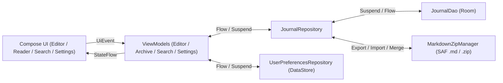

# ARCHITECTURE.md — Architecture & Cartographie du Code

> Ce document décrit les Use Cases de référence, l'architecture cible, le flux de données et l'emplacement exact des fichiers du projet **Mon Simple Journal** afin d'éviter toute exploration inutile du codebase.

---

## 1. Use Cases Nominaux Validés

- **Acteur** : Utilisateur souhaitant écrire son journal quotidien sans distraction, relire ses anciens journaux, rechercher un mot précis ou sauvegarder/transférer ses écrits en `.md` et `.zip`.
- **Parcours 1 — Écriture immédiate, Horodatage & Continuité toute la journée (dont passage de minuit)** :
    1. L'utilisateur ouvre **Mon Simple Journal** (après un Splash Screen sobre reprenant l'icône XML minimaliste, et un déverrouillage biométrique si l'option a été activée) : l'application affiche immédiatement l'écran d'édition du jour avec en titre la date complète du jour en toutes lettres accompagnée du nom du jour (ex. *« Lundi 9 novembre 2026 »*).
    2. Si une entrée existe déjà pour aujourd'hui, son contenu est chargé et prêt à être complété. Sinon, la page est vierge. Un bouton discret permet d'insérer l'heure courante (`— 22:15 —`) au curseur lorsqu'on écrit en plusieurs fois dans la journée.
    3. L'écran reste allumé (`keepScreenOn`) même si l'utilisateur pose son téléphone pour réfléchir.
    4. Si l'utilisateur écrit à `23h55` et que l'horloge passe à `00h00`, la session garde la date d'ancrage initiale : l'écriture ne s'interrompt pas et continue dans le même journal.
- **Parcours 2 — Consultation des anciens journaux (Lecture seule stricte)** :
    1. L'utilisateur ouvre l'historique des journaux précédents et sélectionne une date passée.
    2. Le journal s'ouvre en **mode lecture seule** (`readOnly`) : aucun clavier ne s'ouvre, le texte est sélectionnable/copiable mais strictement non modifiable.
- **Parcours 3 — Recherche d'occurrences insensible aux accents & Saut direct (`▲` / `▼`)** :
    1. L'utilisateur saisit un mot ou une expression dans l'écran de recherche (insensible à la casse et aux accents : taper `"ete"` trouve `"été"`, `"Été"`, `"ete"`).
    2. L'application affiche la liste détaillée de toutes les occurrences trouvées sous forme de liens (date du journal + extrait de phrase mettant le mot en évidence).
    3. Au clic sur une occurrence, l'application ouvre le journal correspondant, fait défiler automatiquement la page (`scroll`) jusqu'à l'emplacement exact de cette occurrence, la surligne, et affiche une barre flottante discrète (`2/5 [▲] [▼] [✕]`) pour sauter d'une occurrence à l'autre dans ce même journal.
- **Parcours 4 — Sauvegarde, Fusion sans perte & Changement de téléphone (`.md` & `.zip`)** :
    1. L'utilisateur peut exporter un journal ou l'intégralité de ses journaux en fichiers Markdown (`.md`) standards, lisibles dans n'importe quel logiciel tiers (Obsidian, Notion, éditeur de texte).
    2. L'utilisateur peut exporter l'ensemble de ses journaux dans une archive `.zip` unique et réimporter ce `.zip` (ou des fichiers `.md`) sur un nouveau téléphone en un clic, avec **fusion intelligente sans perte** (`\n\n---\n\n`) si une date existe déjà localement avec un texte différent.

---

## 2. Vue d'Ensemble (Clean MVVM, UDF & Persistance Locale)



---

## 3. Organisation des Packages (`fr.antoinehory.monsimplejournal`)

```text
fr.antoinehory.monsimplejournal/
├── MainActivity.kt                  # Point d'entrée unique (SplashScreen, verrouillage biométrique optionnel, ouvre l'éditeur du jour)
├── ui/
│   ├── theme/                       # Thème Système Dark/Light + Presets Hungry Cat Nonogram + Couleurs custom + Taille police
│   ├── components/                  # Composants réutilisables (JournalTopBar, OccurrenceNavigatorBar, ContrastPresetPicker, ColorPickerDialog)
│   ├── navigation/                  # Navigation Compose légère (Editor, ArchiveList, ReadOnlyViewer, Search, Settings, Info)
│   ├── editor/                      # Écran d'écriture du jour (EditorScreen, EditorViewModel, EditorUiState)
│   ├── archive/                     # Liste des anciens journaux & vue lecture seule (ArchiveScreen, ReaderScreen, ArchiveViewModel)
│   ├── search/                      # Recherche d'occurrences sans accents avec saut direct (SearchScreen, SearchViewModel, SearchUiState)
│   ├── settings/                    # Réglages : format de date, thème (Auto/Presets/Custom), taille texte, écran actif, biométrie, .md/.zip
│   └── info/                        # Écran À propos, crédits, réseaux sociaux et PayPal (InfoScreen)
├── data/
│   ├── local/
│   │   ├── AppDatabase.kt           # Instance RoomDatabase (mon_simple_journal.db)
│   │   ├── dao/                     # Interfaces @Dao (JournalDao)
│   │   └── entity/                  # Entités Room (@Entity JournalEntryEntity)
│   ├── preferences/                 # DataStore (UserPreferencesRepository, DateFormatOption, ThemeMode, FontScaleOption)
│   ├── backup/                      # Export/Import Markdown (.md) et Archive (.zip) via SAF avec fusion sans perte
│   └── repository/                  # Repositories (JournalRepository)
└── domain/                          # Modèles métier purs (JournalEntry, SearchOccurrence, ContrastPalette, JournalDateFormatter, DiacriticsMatcher)
```

---

## 4. Cartographie des Fichiers du Projet

*Mettre à jour ce tableau à chaque création, modification structurante ou suppression de fichier.*

| Chemin relatif | Responsabilité | Statut |
| :--- | :--- | :--- |
| `AGENTS.md` | Point d'entrée IA, index documentaire, catalogue de skills et garde-fous | Actif |
| `docs/ARCHITECTURE.md` | Use Cases, architecture MVVM/UDF, spécifications techniques et cartographie | Actif |
| `docs/CODING_STANDARDS.md` | Standards de code Kotlin/Compose et bonnes pratiques Room/DataStore/SAF | Actif |
| `docs/ROADMAP.md` | Suivi d'avancement par phases | Actif |
| `docs/DECISIONS.md` | Journal des décisions d'architecture (ADR-001 à ADR-011) | Actif |
| `settings.gradle.kts` | Configuration du projet racine (`rootProject.name = "Mon Simple Journal"`) | Actif |
| `build.gradle.kts` | Configuration Gradle racine (plugins Android Application, Kotlin Compose, KSP) | Actif |
| `gradle/libs.versions.toml` | Catalogue des versions (AGP 9.5.1, Kotlin 2.2.10, Compose BOM 2026.02.01, Room 2.8.5, DataStore 1.1.3, SplashScreen 1.2.0, Biometric 1.1.0, KSP 2.3.13) | Actif |
| `app/build.gradle.kts` | Configuration du module `:app` (`namespace = "fr.antoinehory.monsimplejournal"`, `minSdk = 29`, `targetSdk = 37`) | Actif |
| `app/src/main/AndroidManifest.xml` | Déclaration `MainActivity` (`adjustResize`, thème `Theme.MonSimpleJournal.Starting`, zéro permission réseau) | Actif |
| `app/src/main/res/drawable/ic_launcher_foreground.xml` | Icône vectorielle XML simple et minimaliste (carnet épuré) pour Launcher & Splash Screen | Actif |
| `app/src/main/res/drawable/ic_launcher_background.xml` | Fond vectoriel XML sobre (`#2B2D30`) de l'icône adaptative | Actif |
| `app/src/main/res/values/colors.xml` | Couleurs de base et fond clair du Splash Screen | Actif |
| `app/src/main/res/values-night/colors.xml` | Fond sombre du Splash Screen (`#2B2D30`) respectant le mode nuit du téléphone | Actif |
| `app/src/main/res/values/themes.xml` | Thème XML incluant la configuration `Theme.MonSimpleJournal.Starting` (`core-splashscreen`) | Actif |
| `app/src/main/res/values/strings.xml` | Ressources textuelles (`app_name = "Mon Simple Journal"`) et traductions (`values-en`, `values-es`, `values-pt`) | Actif |
| `app/src/main/java/fr/antoinehory/monsimplejournal/MainActivity.kt` | Activité hôte (`FragmentActivity` / `ComponentActivity`), `installSplashScreen()`, biométrie optionnelle et `EditorRoute` | Actif |
| `app/src/main/java/fr/antoinehory/monsimplejournal/ui/theme/Color.kt` | Couleurs de base et palettes de contraste (`ContrastPreset`) | Actif |
| `app/src/main/java/fr/antoinehory/monsimplejournal/ui/theme/Theme.kt` | `MonSimpleJournalTheme` gérant le mode Système Dark/Light (`isSystemInDarkTheme()`), les presets, les couleurs custom et la police | Actif |
| `app/src/main/java/fr/antoinehory/monsimplejournal/ui/theme/Type.kt` | Typographie Material 3 avec choix de la famille de police (`FontFamilyOption` : Sans, Serif, Monospace) et taille (`FontScaleOption`) | Actif |
| `app/src/main/java/fr/antoinehory/monsimplejournal/domain/JournalEntry.kt` | Modèle métier immuable (`@Immutable`) d'une entrée de journal | Actif |
| `app/src/main/java/fr/antoinehory/monsimplejournal/domain/SearchOccurrence.kt` | Modèle d'une occurrence de mot trouvée (`entryDate`, `occurrenceIndex`, `charOffset`, `snippet`) | Actif |
| `app/src/main/java/fr/antoinehory/monsimplejournal/domain/DiacriticsMatcher.kt` | Recherche d'occurrences insensible aux accents (`Normalizer.Form.NFD`) et à la casse avec préservation des `charOffset` | Actif |
| `app/src/main/java/fr/antoinehory/monsimplejournal/domain/JournalDateFormatter.kt` | Formatage configurable du titre (date en toutes lettres + nom du jour) et de l'horodatage intra-journée (`— HH:mm —`) | Actif |
| `app/src/main/java/fr/antoinehory/monsimplejournal/domain/ContrastPalette.kt` | Mode Automatique Système (Dark/Light), Presets (*Hungry Cat Nonogram*), Palette personnalisée, Taille et Famille de police (`FontFamilyOption`) | Actif |
| `app/src/main/java/fr/antoinehory/monsimplejournal/domain/MarkdownTextFormatter.kt` | Formateur Markdown léger (Titres H1/H2/H3, Gras, Italique, Souligné, Listes UL/OL avec continuation auto) et constructeur d'`AnnotatedString` | Actif |
| `app/src/main/java/fr/antoinehory/monsimplejournal/data/local/entity/JournalEntryEntity.kt` | Entité Room `journal_entries` (`epochDay` / `isoDate`, `content`, `createdAt`, `updatedAt`) | Actif |
| `app/src/main/java/fr/antoinehory/monsimplejournal/data/local/dao/JournalDao.kt` | Interface `@Dao` réactive (`Flow` + `suspend`) pour l'édition du jour, l'historique et la recherche | Actif |
| `app/src/main/java/fr/antoinehory/monsimplejournal/data/local/AppDatabase.kt` | Singleton `RoomDatabase` (`mon_simple_journal.db`) | Actif |
| `app/src/main/java/fr/antoinehory/monsimplejournal/data/preferences/UserPreferencesRepository.kt` | Gestion DataStore (format date, mode thème Auto/Preset/Custom, couleurs custom, famille et taille de police, `keepScreenOn`, `biometricLock`) | Actif |
| `app/src/main/java/fr/antoinehory/monsimplejournal/data/backup/MarkdownZipManager.kt` | Sérialisation `.md`, compression/décompression `.zip` via SAF et fusion intelligente sans perte | Actif |
| `app/src/main/java/fr/antoinehory/monsimplejournal/data/repository/JournalRepository.kt` | Orchestration CRUD Room, recherche d'occurrences normalisée et import/export avec fusion | Actif |
| `app/src/main/java/fr/antoinehory/monsimplejournal/ui/components/OccurrenceNavigatorBar.kt` | Barre flottante (`2/5 [▲] [▼] [✕]`) de navigation entre occurrences dans un journal | Actif |
| `app/src/main/java/fr/antoinehory/monsimplejournal/ui/components/FormattingToolbar.kt` | Barre d'outils de mise en forme (`H1`, `H2`, `H3`, `Gras`, `Italique`, `Souligné`, `Liste UL`, `Liste OL`) | Actif |
| `app/src/main/java/fr/antoinehory/monsimplejournal/ui/components/ColorPickerDialog.kt` | Boîte de dialogue HSV + Hexadécimal `#RRGGBB` pour choisir les couleurs de fond et de texte | Actif |
| `app/src/main/java/fr/antoinehory/monsimplejournal/ui/editor/EditorUiState.kt` | État UI immuable et événements (`EditorUiEvent`) de l'écran d'écriture du jour | Actif |
| `app/src/main/java/fr/antoinehory/monsimplejournal/ui/editor/EditorViewModel.kt` | Gestion de l'entrée du jour, ancrage de la date à 23h55, outils de formatage, insertion de l'heure et sauvegarde automatique | Actif |
| `app/src/main/java/fr/antoinehory/monsimplejournal/ui/editor/EditorScreen.kt` | Écran minimaliste d'écriture du jour avec titre auto, barre de formatage, bouton horodatage et `Modifier.keepScreenOn()` | Actif |
| `app/src/main/java/fr/antoinehory/monsimplejournal/ui/navigation/JournalNavHost.kt` | Graphe Navigation Compose démarrant directement sur l'éditeur du jour | Actif |
| `app/src/main/java/fr/antoinehory/monsimplejournal/ui/archive/ArchiveViewModel.kt` | ViewModel observant les journaux passés par ordre antéchronologique | Actif |
| `app/src/main/java/fr/antoinehory/monsimplejournal/ui/archive/ArchiveScreen.kt` | Liste antéchronologique des journaux passés | Actif |
| `app/src/main/java/fr/antoinehory/monsimplejournal/ui/archive/ReaderViewModel.kt` | ViewModel de consultation en lecture seule et d'export `.md` individuel | Actif |
| `app/src/main/java/fr/antoinehory/monsimplejournal/ui/archive/ReaderScreen.kt` | Écran de lecture seule d'un ancien journal avec rendu Markdown, saut direct et barre flottante inter-occurrences (`▲` / `▼`) | Actif |
| `app/src/main/java/fr/antoinehory/monsimplejournal/ui/search/SearchViewModel.kt` | ViewModel de recherche plein texte insensible aux accents avec `debounce(150ms)` | Actif |
| `app/src/main/java/fr/antoinehory/monsimplejournal/ui/search/SearchScreen.kt` | Recherche plein texte insensible aux accents et liste détaillée des occurrences cliquables | Actif |
| `app/src/main/java/fr/antoinehory/monsimplejournal/ui/settings/SettingsViewModel.kt` | ViewModel des paramètres utilisateur et de l'export/import `.md` / `.zip` | Actif |
| `app/src/main/java/fr/antoinehory/monsimplejournal/ui/settings/SettingsScreen.kt` | Réglages (format de date, thème Système/Presets/Custom, famille et taille de police, écran actif, biométrie, sauvegarde `.md`/`.zip`) | Actif |
| `app/src/main/java/fr/antoinehory/monsimplejournal/ui/info/InfoScreen.kt` | Écran À propos, crédits, réseaux sociaux et PayPal | Actif |
| `app/src/test/java/fr/antoinehory/monsimplejournal/ExampleUnitTest.kt` | Suite de tests unitaires JVM (continuité minuit `23h55`➔`00h00`, immuabilité lecture seule, recherche sans accents, formatage Markdown, export/import `.zip`) | Actif |
| `app/src/androidTest/java/fr/antoinehory/monsimplejournal/ExampleInstrumentedTest.kt` | Tests instrumentés Room en mémoire de `JournalDao` et `AppDatabase` | Actif |

---

## 5. Spécifications Techniques Clés

### 5.1. Ancrage de la Session du Jour, Horodatage & Passage de Minuit (23h55 ➔ 00h00)
- À l'initialisation de `EditorViewModel`, la propriété `sessionDate: LocalDate = LocalDate.now(clock)` est capturée.
- Tant que l'utilisateur reste dans sa session d'écriture (même si l'horloge système franchit `00:00`), toutes les sauvegardes automatiques continuent d'utiliser `sessionDate`.
- Le basculement vers le nouveau jour ne s'effectue que lorsque l'application est réouverte à froid un nouveau jour ou après une période d'inactivité prolongée en arrière-plan (`> 30 minutes` après un `ON_STOP` lorsque la date calendaire a changé).
- Un bouton discret « Insérer l'heure » dans la barre supérieure permet d'insérer `— HH:mm —` à la position actuelle du curseur (`TextFieldValue.selection`).

### 5.2. Recherche d'Occurrences sans Accents, Saut Direct & Barre `▲` / `▼`
- Lorsqu'un mot `query` est recherché :
    1. `DiacriticsMatcher` normalise le texte et la requête (`Normalizer.Form.NFD` + suppression des marques diacritiques `\p{Mn}` + `lowercase`) tout en conservant une table de correspondance exacte des indices vers le texte original. Ainsi, chercher `"ete"` trouve `"été"`, `"Été"` et `"ete"`.
    2. Pour chaque entrée, toutes les occurrences sont extraites : si un même journal contient 5 fois le mot, **5 éléments distincts** (`SearchOccurrence`) sont générés dans la liste des résultats, chacun avec son extrait contextuel (`...40 caractères avant **[mot]** 40 caractères après...`), son `charOffset` exact et son `occurrenceIndex`.
    3. Au clic sur un résultat, la navigation ouvre le journal cible en passant `highlightQuery` et `initialOccurrenceIndex`.
    4. Le Composable mesure la position verticale exacte du caractère via `TextLayoutResult.getBoundingBox(targetCharOffset).top`, anime le `ScrollState` (`scrollState.animateScrollTo(...)`) pour amener la ligne au centre de l'écran, et affiche en bas une pilule flottante **`2/5  [▲] [▼]  [✕]`** permettant de naviguer entre les occurrences du même journal.

### 5.3. Thème Système Dark/Light, Presets (*Hungry Cat Nonogram*), Couleurs Custom & Taille de Police
- **Gestion du thème Dark / Light du smartphone** :
    - Par défaut, le mode **`SYSTEM_AUTO`** suit automatiquement l'état clair/sombre du smartphone (`isSystemInDarkTheme()`) : il applique *Gris Papier* (ou *Blanc Pur*) en mode Jour et *Gris Ardoise* (ou *Noir OLED*) en mode Nuit, tout en mettant à jour l'apparence des barres système (`WindowInsetsControllerCompat.isAppearanceLightStatusBars`).
- **Presets de contraste fixes** inspirés de *Hungry Cat Nonogram* :
    - **Noir profond (OLED)** : Fond `#000000`, Texte `#EBEBEB`, Accent `#8AB4F8`
    - **Gris ardoise (Doux)** : Fond `#2B2D30`, Texte `#E8EAED`, Accent `#A8C7FA`
    - **Gris clair (Papier neutre)** : Fond `#E5E5E0`, Texte `#1F1F1F`, Accent `#3B5998`
    - **Blanc pur (Haut contraste jour)** : Fond `#FFFFFF`, Texte `#111111`, Accent `#1A73E8`
    - **Sépia / Monogramme chaud** : Fond `#F4ECD8`, Texte `#3C2F2F`, Accent `#8C5A3C`
- **Mode Personnalisé (`CUSTOM`)** : L'utilisateur choisit librement la couleur du fond et du texte (roue HSV + saisie Hexadécimale `#RRGGBB`) avec aperçu en temps réel.
- **Taille de police ajustable (`FontScaleOption`)** : *Petit (`0.9f`)*, *Normal (`1.0f`)*, *Grand (`1.15f`)*, *Très grand (`1.3f`)*.

### 5.4. Format de Sauvegarde `.md`, Archive `.zip` & Fusion sans Perte
- **Structure d'un fichier `.md`** :
    - Nom du fichier : `YYYY-MM-DD.md` (ex. `2026-11-09.md`).
    - Contenu du fichier :
      ```markdown
      # Lundi 9 novembre 2026
  
      Contenu du journal écrit par l'utilisateur...
      ```
- **Export `.zip`** : Génère un fichier `mon_simple_journal_backup_YYYYMMDD.zip` contenant tous les fichiers `YYYY-MM-DD.md`.
- **Import `.zip` / `.md` avec fusion sans perte** : Lit chaque entrée `YYYY-MM-DD.md`. Si une entrée pour la même date `YYYY-MM-DD` existe déjà dans Room avec un contenu différent et non vide, les deux contenus sont fusionnés proprement avec un séparateur `\n\n---\n\n` afin qu'aucun écrit ne soit jamais perdu.

---

## 6. Persistance Locale avec Room (`data/local/`)

- **Entité principale (`JournalEntryEntity`)** :
    - `isoDate: String` (Clé primaire au format `YYYY-MM-DD`, ex. `"2026-11-09"`)
    - `epochDay: Long` (`LocalDate.toEpochDay()`, indexé pour un tri chronologique ultra-rapide)
    - `content: String` (Corps du texte du journal)
    - `createdAt: Long` (Timestamp epoch millis de création)
    - `updatedAt: Long` (Timestamp epoch millis de dernière modification)
- **DAO (`JournalDao`)** :
    - `observeByDate(isoDate: String): Flow<JournalEntryEntity?>`
    - `getByDate(isoDate: String): JournalEntryEntity?` (`suspend`)
    - `observeAllPastEntries(todayIsoDate: String): Flow<List<JournalEntryEntity>>` (Trié par `epochDay DESC`)
    - `observeAllEntries(): Flow<List<JournalEntryEntity>>` (Trié par `epochDay DESC`, utilisé pour la recherche normalisée sans accents et l'export)
    - `upsert(entity: JournalEntryEntity)` (`suspend`)
    - `upsertAll(entities: List<JournalEntryEntity>)` (`suspend`, utilisé lors de l'import `.zip`)
